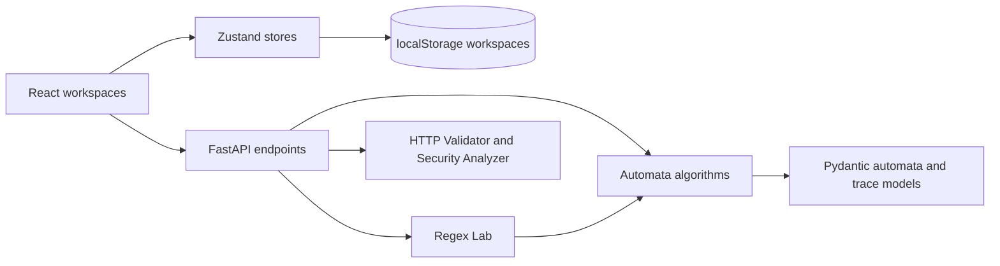

# Smart Web/API Request Validation & Security Analyzer

An Automata Theory project for building, simulating, transforming and comparing finite automata, then applying them to HTTP request validation.

## Security Analyzer limitations

The Security Analyzer compiles detection patterns through the Regex Lab engine and checks requests after up to two URL-decoding passes, case folding, and whitespace normalization. These automata-based filters are a first line of defense only. They do not replace parameterized database queries, context-appropriate output encoding, input validation, or other application security controls. A clean result is not proof that a request or application is safe, and findings should be reviewed in context.

## Stack

- **Frontend:** React, TypeScript, Vite, Tailwind CSS, React Flow, Framer Motion, Zustand, Vitest
- **Backend:** Python 3.11+, FastAPI, Pydantic, pytest
- **Layout:** `frontend/` and `backend/` monorepo

## Run locally

### Frontend

```bash
npm install
npm run dev
```

Vite serves the app at http://localhost:5173.

### Backend

```bash
cd backend
python -m venv .venv
# Windows: .venv\Scripts\Activate.ps1
# macOS/Linux: source .venv/bin/activate
pip install -e ".[dev]"
uvicorn app.main:app --reload --port 8000
```

The API health check is at http://localhost:8000/health and interactive API docs are at http://localhost:8000/docs.

### Checks

```bash
npm test
npm run build
cd backend && pytest
```

The backend allows the Vite development origin at `http://localhost:5173`. Automata algorithms are intentionally added feature by feature in `backend/app/automata`.

## Architecture



The browser owns editing, navigation, visualization, and locally saved workspace snapshots. FastAPI owns parsing, validation, simulation, automata conversion, minimization, language equivalence, and security matching. Each algorithm returns a trace that the UI can step through.

## Theory to Feature mapping

| Theory concept | Where to explore it |
| --- | --- |
| DFA/NFA/ε-NFA, start and accepting states, symbol classes | Automata Builder and Simulator |
| Thompson construction and regular-expression parsing | Regex Lab |
| Subset construction and ε-closure | Transform & Optimize |
| Myhill–Nerode equivalence and DFA minimization | Transform & Optimize · table filling / Hopcroft |
| Product automata, BFS, shortest distinguishing string | Equivalence Checker |
| Token languages and maximal-munch scanning | Lexer |
| Protocol constraints and formal request rules | HTTP Validator |
| OpenAPI operation, parameter, security declaration, and JSON Schema checks | HTTP Validator · OpenAPI contract |
| Regular-language signatures, normalization, defense in depth | Security Analyzer |

Each page has a **Learn** panel with a short theory guide. The first visit also offers a five-step guided tour. Features can be explored independently using the guided tour, sample inputs, and one-click automaton handoffs.

### OpenAPI contract validation

The HTTP Validator can additionally validate requests against OpenAPI 3.0 and 3.1 documents in JSON or YAML. Paste a contract or import a `.json`, `.yaml`, or `.yml` file, then enable **Enforce contract**. The report combines the existing HTTP protocol checks with operation/path matching, declared path/query/header/cookie parameter checks, required request bodies, content types, JSON body schemas, and declared security credential presence. Local `$ref` references are supported; remote references are blocked. Parameter serialization currently covers common simple/form/delimited styles rather than every OpenAPI serialization combination. Non-JSON body schemas are not inspected. Authentication checks only establish whether a credential is present in the expected location/format; they do not verify signatures, token expiry, scopes, authorization, or credentials against a live service. This is a static request checker, not a proxy or a live API call.

The endpoint is `POST /api/http/validate-contract`, with `rawRequest`, `openApiSpec`, and optional HTTP validator settings. OpenAPI contract analysis complements the raw HTTP checks; it does not replace server-side validation or security controls in the actual API.

## Workspace files and screenshots

Use **Save** to snapshot the current automaton, regex draft, and request into the selected local workspace. **New** creates another workspace. The JSON buttons export or import a complete workspace file; imported data is shape-checked before it is loaded. Workspaces are stored in the browser's `localStorage` under `automata-studio-workspaces`.

To capture current UI screenshots for documentation or bug reports:

1. Start the backend and frontend using the commands above.
2. Open `http://localhost:5173`, close the first-visit tour if it covers the target, and choose the page to capture.
3. Use the browser's screenshot command at a consistent desktop viewport (for example 1440 × 1000), and save images under `docs/screenshots/` with descriptive names such as `builder.png`, `regex-lab.png`, and `security-analyzer.png`.
4. For a light-theme capture, use the theme button before taking the screenshot. Screenshots are intentionally generated from the running UI rather than checked in as stale assets.

## Browser smoke test

With Python backend dependencies installed and Playwright's Chromium browser available, run:

```bash
npm run test:e2e --workspace frontend
```

The Playwright config starts the API and Vite server when they are not already running. Install the browser once with `npx playwright install chromium` if needed. The smoke tests cover page navigation, the Learn panel, one-click automaton handoff, the command palette, workspace import/export, and responsive layouts.
